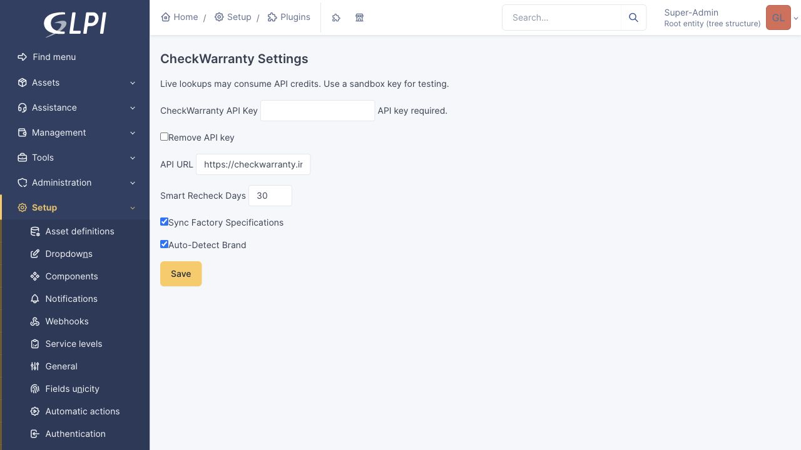
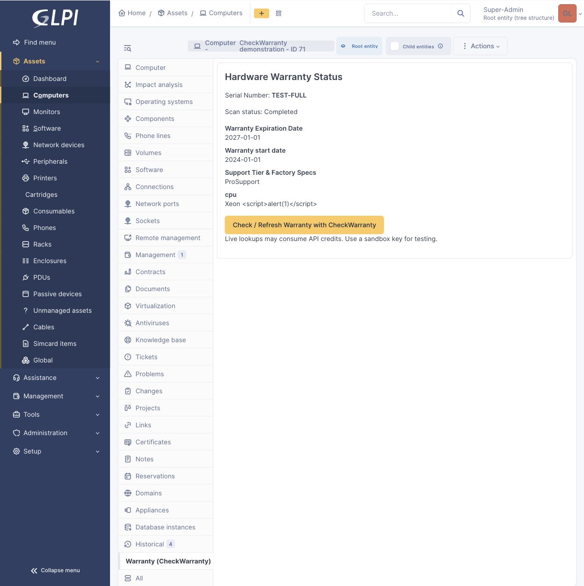

# CheckWarranty for GLPI

Native GLPI plugin for hardware warranty lookup through [CheckWarranty](https://checkwarranty.info), licensed under GPL-3.0-or-later.

Version **1.0.1** supports GLPI **10.0.28–10.x** and **11.0.12–11.x**. Runtime acceptance uses GLPI 10.0.28 and 11.0.12. Catalog submission and moderator approval are separate from a GitHub release; this project does not claim official GLPI approval.

## Features

- Computer warranty tab with manual refresh and factory specification notes.
- Native financial data synchronization without inventing purchase dates.
- End dates retained in warranty information; native start/months written only for confirmed exact calendar intervals.
- Useful partial results preserve previously known warranty details.
- Encrypted API key, per-object/entity permissions, CSRF protection and escaped output.
- Bounded automatic synchronization with a persistent cursor and resumable asynchronous requests.
- English, French and Russian interface.

A CheckWarranty API key is required. Live lookups can consume paid credits, including useful partial results. Use a sandbox key for testing. Provider errors, empty serial echoes and not-found responses are not useful device results. The plugin caches recent results and resumes pending requests to avoid duplicate work; intentional later refreshes can be billable.

## Installation

1. Download `glpi-checkwarranty-1.0.1.tar.gz` or `.zip` from [Releases](https://github.com/checkwarranty/glpi-plugin-checkwarranty/releases).
2. Check the SHA-256 checksum supplied with the release and extract the single `checkwarranty/` directory into GLPI's `plugins/` directory.
3. Install and activate CheckWarranty in **Setup > Plugins**.
4. Open its configuration, enter your API key and keep the default HTTPS API endpoint unless using an isolated test service. An empty key field preserves an existing key; the clear checkbox removes it.
5. Open a Computer with a serial number and use its CheckWarranty tab. Computer update and financial information update rights are required for synchronization; financial read rights are required to view the data.
6. If scheduled synchronization is wanted, configure GLPI's external automatic-action runner and enable the CheckWarranty action. It starts disabled and processes at most four API calls within a 35-second budget per run.

Back up the database before an upgrade. Deactivation preserves settings and scan history. Uninstall removes the plugin's configuration and request-state tables, but keeps warranty information already written to native GLPI financial records. Deleting a Computer removes its plugin request state.

## Interface





## Development and verification

Requirements: PHP 8.0+, curl/json extensions, Composer, Python 3, GNU gettext (`msgfmt`), tar, zip and shasum. The GLPI core may require a newer PHP version than the plugin itself.

```bash
composer validate --strict
composer lint
composer test
php-cs-fixer fix --dry-run --diff
bash tools/package.sh v1.0.1
bash tests/acceptance/run.sh
```

The last command launches isolated GLPI 10/11 databases and a fake B2B server with Docker; it performs no paid scans. It verifies lifecycle operations, actual database writes, async/partial/error responses, authorization, encryption, CSRF, output escaping and progress beyond 50 assets.

Archives contain one top-level `checkwarranty/` directory with runtime files and translations. Credentials, tests and development tools are excluded. See [RELEASE.md](RELEASE.md) for release evidence and publication details.
